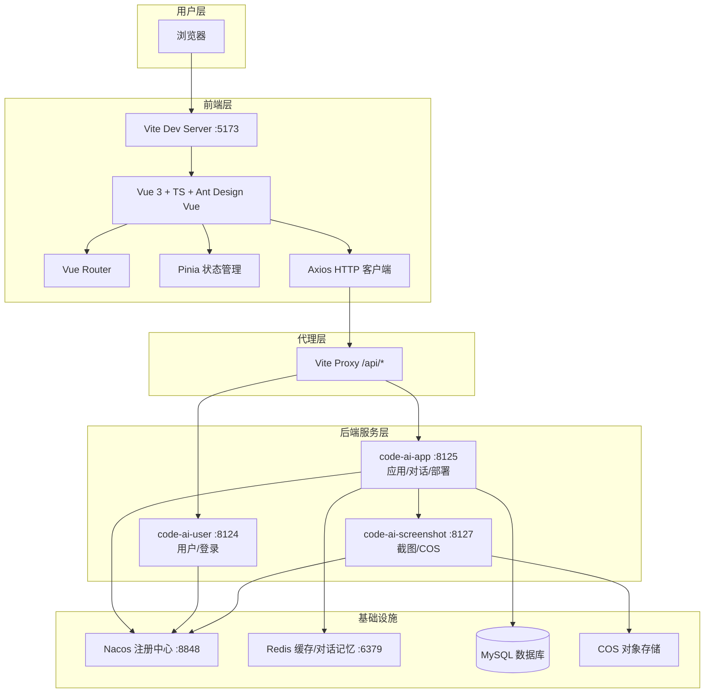

# gzy前端项目秒搭 - 前端

基于 AI 的零代码前端应用生成平台前端项目。用户通过自然语言对话即可生成并部署 Web 应用，支持原生 HTML、多文件工程、Vue 项目三种构建模式。


## 项目架构图



## 功能模块

### 用户端

| 模块 | 说明 |
|------|------|
| 🏠 首页 | 应用展示、提示词输入、快捷操作、我的应用/精选应用列表 |
| 💬 AI 对话生成 | 与 AI 多轮对话生成代码，SSE 流式实时输出，右侧实时预览 |
| 🚀 一键部署 | 将生成的应用部署到静态服务器，获得可访问 URL |
| 📝 应用管理 | 修改应用名称、删除应用、查看应用详情 |
| 👀 应用预览 | iframe 实时预览生成的页面效果 |
| 🔐 用户登录注册 | 账号注册、登录、会话管理 |

### 管理端

| 模块 | 说明 |
|------|------|
| 📊 应用管理 | 全量应用查询、编辑、删除、设置精选 |
| 👥 用户管理 | 用户信息查询与管理 |
| 💬 对话管理 | 对话记录查看 |

### 代码生成模式

| 模式 | 适用场景 | 产物 |
|------|----------|------|
| 原生 HTML | 简单单页应用（计算器、表单、展示页） | 单个 HTML 文件 |
| 多文件模式 | 中等复杂度应用 | HTML + CSS + JS 多文件 |
| Vue 项目模式 | 复杂交互应用 | Vue 3 + Vite 完整工程 |

## 技术选型

### 核心框架
- **Vue 3.5** - 渐进式前端框架，Composition API
- **TypeScript 5.8** - 类型安全
- **Vite 7** - 极速构建工具
- **Ant Design Vue 4** - 企业级 UI 组件库

### 状态与路由
- **Vue Router 4** - 前端路由管理
- **Pinia 3** - 轻量级状态管理

### 网络与工具
- **Axios** - HTTP 客户端，统一请求拦截
- **markdown-it** - Markdown 渲染（AI 回复展示）
- **highlight.js** - 代码高亮

### 工程化
- **ESLint 9** - 代码检查
- **Prettier** - 代码格式化
- **@umijs/openapi** - 根据后端 Swagger 自动生成 TS 接口类型

## 项目结构

```
src/
├── api/                    # API 接口定义（自动生成）
├── assets/                 # 静态资源（logo、AI 头像）
├── components/             # 公共组件
│   ├── GlobalHeader.vue    # 全局头部
│   ├── GlobalFooter.vue    # 全局底部
│   ├── AppCard.vue         # 应用卡片
│   └── MarkdownRenderer.vue
├── config/                 # 环境配置
├── layouts/                # 布局组件
├── pages/                  # 页面
│   ├── HomePage.vue        # 首页
│   ├── app/                # 应用对话/编辑页
│   ├── admin/              # 管理员页面
│   └── user/               # 登录/注册页
├── router/                 # 路由配置
├── stores/                 # Pinia 状态
└── utils/                  # 工具函数
```

## 快速开始

### 环境要求
- Node.js >= 18
- npm >= 9

### 安装依赖
```sh
npm install
```

### 启动开发服务
```sh
npm run dev
```
访问 http://localhost:5173

### 构建生产版本
```sh
npm run build
```

## 环境配置

`.env.development`:
```env
VITE_DEPLOY_DOMAIN=http://localhost:8125/api/deploy
VITE_API_BASE_URL=/api
```

Vite 代理配置（vite.config.ts）将 `/api/*` 转发到对应后端服务：
- `/api/user` → code-ai-user (8124)
- `/api/app`、`/api/chatHistory`、`/api/static`、`/api/deploy`、`/api/workflow` → code-ai-app (8125)

## 后端项目

后端仓库：[code-ai-generate](../code-ai-generate)

## 许可证

MIT